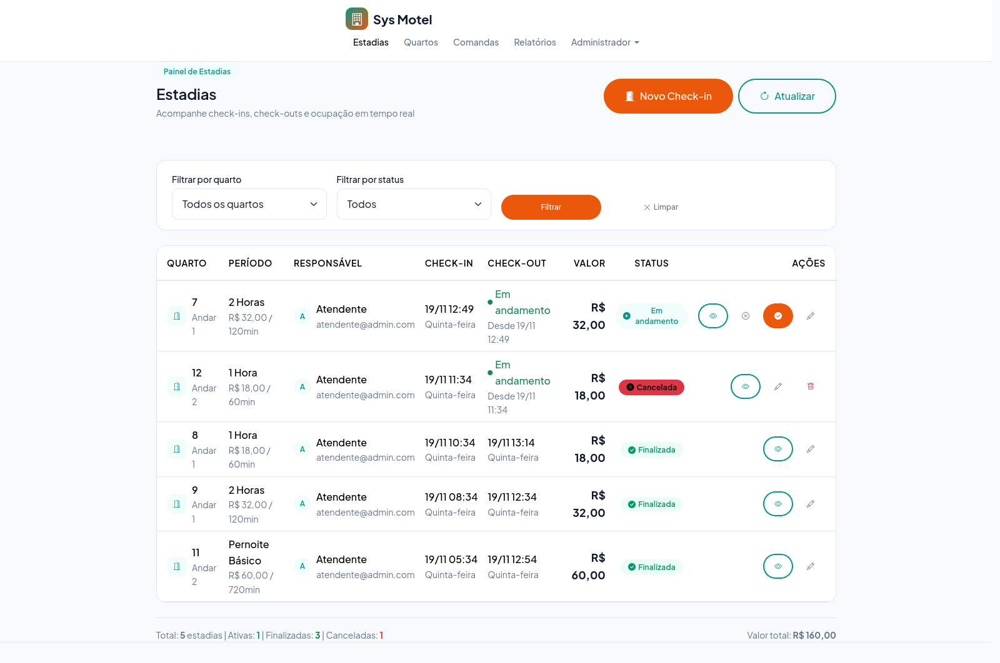
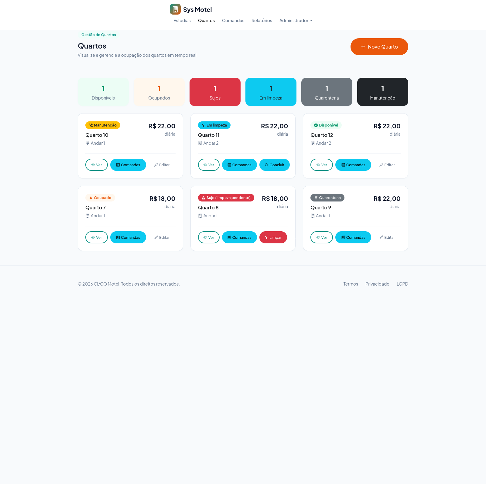
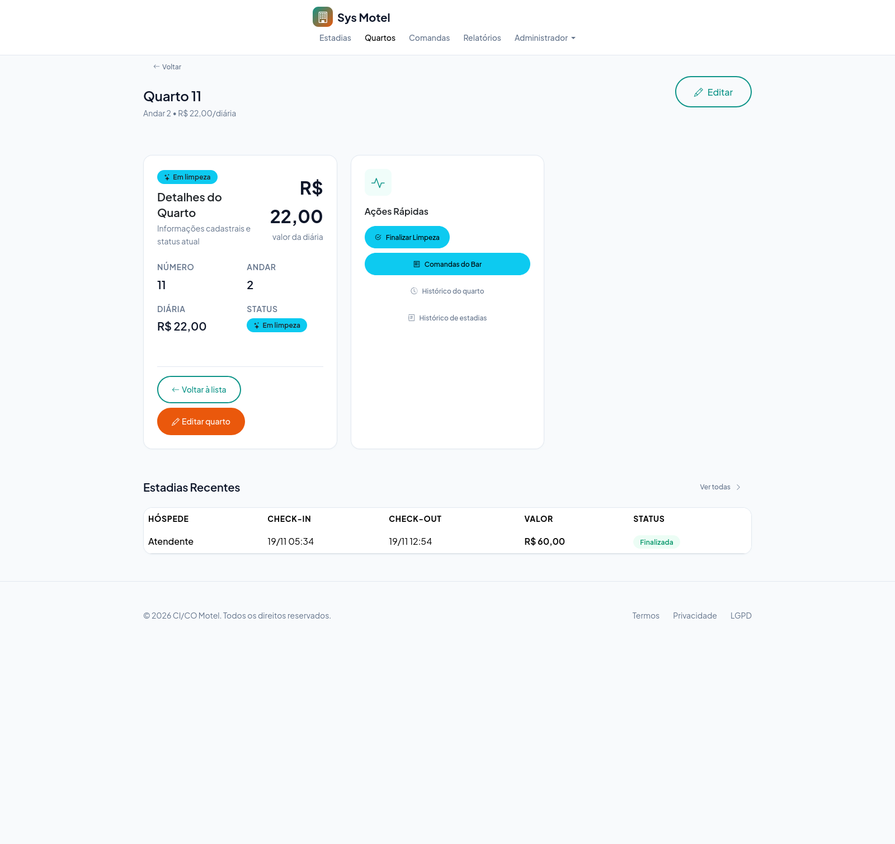
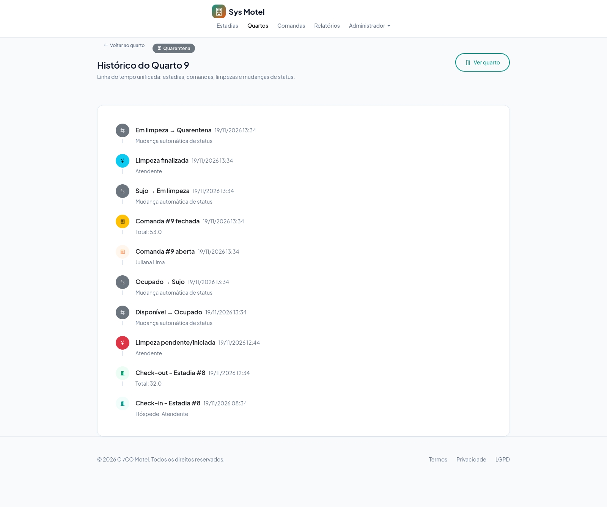
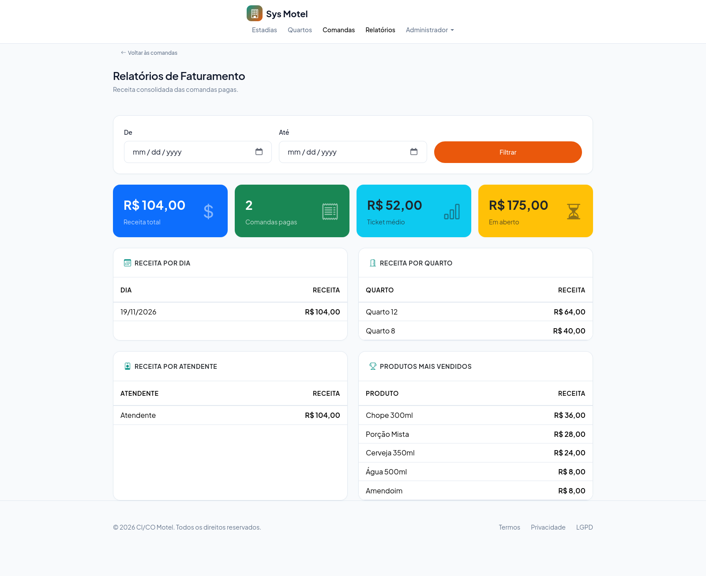

# MotelFlow

Sistema de gestão para motéis: check-in/check-out, controle de quartos, comandas de bar, precificação dinâmica e ciclo de limpeza. Feito com **Ruby on Rails 8**, **Bootstrap 5**, **Turbo/Stimulus**, **Solid Queue**, **Solid Cache** e **Solid Cable**.

[](https://github.com/codebyjonatas/MotelFlow/actions/workflows/ci.yml)
[](https://rubygems.org/gems/rails/8.1.4.1)
[](https://rubygems.org/gems/rails/8.1.4.1)
[](https://www.postgresql.org/)
[](LICENSE)

> Painel operacional, ciclo AASM de quartos, comandas de bar com itens e precificação dinâmica, autorização com Pundit e timestamps em UTC com fuso America/Sao_Paulo.

## Demo

**Fluxo completo do sistema:**

1. Login - Acesso com credenciais admin (admin@admin.com) ou atendente (atendente@admin.com)
   *Ver: 00-login_annotated.png*
2. Check-in - Seleção de quarto, período de preço (1H/2H/Pernoite) e confirmação do valor
   *Ver: 02-checkin_annotated.png*
3. Check-out - Finalização da estadia, quarto enviado para limpeza (status: dirty)
   *Ver: 03-estadia_annotated.png (before) e 05-quarto-em-limpeza_annotated.png (after)*
4. Ciclo de limpeza - dirty → cleaning → quarantine (30 min) → available
   *Ver: 05-quarto-em-limpeza_annotated.png e 06-quarto-em-quarentena_annotated.png*
5. Comandas - Abertura por quarto/estadia ou passante (walk-in); itens e totais recalculados
   *Ver: 08-comandas_annotated.png*
6. Relatórios - Faturamento e resumos financeiros
   *Ver: 10-relatorios_annotated.png*

[▶️ Ver demo ao vivo](https://motelflow-ctp3.onrender.com) · [📸 Screenshots](docs/screenshots/)

*Legendas explicativas disponíveis nas versões annotadas (00-login_annotated.png a 10-relatorios_annotated.png), que indicam cada etapa do fluxo em tempo real.*

## Índice

| Tela | Screenshot | Detalhes |
|---|---|---|
| Estadias |  | Visualização das estadias ativas |
| Check-in |  | Seleção de quarto e período de preço |
| Detalhe da estadia |  | Informações da estadia e valores |
| Quartos |  | Lista de quartos com taxa base e status |
| Quarto em limpeza |  | Quarto em processo de limpeza |
| Quarentena |  | Quarto em quarentena (30 min) |
| Histórico do quarto |  | Histórico de status e movimentações |
| Comandas |  | Central de comandas do bar |
| Detalhe da comanda |  | Itens e total da comanda |
| Relatórios |  | Faturamento e relatórios financeiros |

## Arquitetura

### Models principais

- **Room** — AASM: `available → occupied → dirty → cleaning → quarantine → maintenance`; `RoomAuditable` registra cada transição em `RoomStatusLog`; `belongs_to :cleaned_by`.
- **Stay** — `status: { active: 0, completed: 1, cancelled: 2 }`; `total_value = price_period.price`; validação de período compatível com horário de check-in (Happy Hour / madrugada).
- **PricePeriod** — estrutura estática via `PricePeriodConfig` (não é model ativo). Períodos: `one_hour` (R$18/60min), `two_hours` (R$32/120min), `basic_overnight` (R$60/720min), `advanced_overnight` (R$70/720min).
- **Tab / TabItem** — comandas do bar; itens com quantidades, preço unitário/Total; descontos e totais recalculados automaticamente.
- **CleaningLog** — enum `started/finished/approved/rejected`; `cleaned_by` obrigatório (setado no check-out).
- **User** — Devise + Rolify; papéis `admin` e `attendant`.

### Queries (`app/queries`)

- `RoomHistoryQuery` — linha do tempo unificada: estadias, comandas, limpezas, mudanças de status.
- `TabDashboardQuery` — resumo operacional e filtros de status/data.
- `AvailableRoomsQuery` — quartos disponíveis para check-in agora (considera quarentena).
- `TabReportQuery` — faturamento por período, quarto, atendente e produtos mais vendidos.

### Services (`app/services`)

- `Stays::CheckInService` — validação de quarto, período, senha do atendente e criação atômica da estadia.
- `Stays::CheckOutService` — fecha comanda, define `check_out`, status `completed` e coloca quarto em `dirty` + `CleaningLog`.
- `Tabs::CloseService` / `Tabs::PayService` / `Tabs::CancelService` — operações de comanda com validação de limites de desconto.

### Auth & Authz

- **Devise** com `admin` e `attendant` roles (via Rolify).
- **Pundit** policies: `StayPolicy`, `RoomPolicy`, `TabPolicy`, `TabItemPolicy`, `ProductPolicy`.
- `Current` attribute object para contexto de usuário/trigger de status.

## Início Rápido

```bash
# 1. Clone o repositório
git clone https://github.com/codebyjonatas/MotelFlow.git
cd MotelFlow

# 2. Instale as dependências
brew bundle install  # ou: rvm use 4.0.5 && rvm gemset create motelflow
# Ou manualmente:
bundle install && yarn install

# 3. Configure o banco e o fuso horário
cp .env.example .env.local   # ajuste RAILS_MASTER_KEY e APP_TIME_ZONE
export APP_TIME_ZONE="America/Sao_Paulo"

# 4. Crie o banco e faça o seed
bin/rails db:setup

# 5. Rode a aplicação
bin/dev   # ou: rails server
```

> Já tinha o projeto clonado antes da renomeação? Recrie o banco local com `bin/rails db:drop db:setup` — os bancos agora se chamam `motelflow_*`.

## Comandos Principais

| Tarefa | Comando |
|--------|---------|
| Rodar testes | `rails test` |
| Rodar testes de sistema | `rails test:system` |
| Lint | `bin/rubocop` |
| Scan segurança (Ruby) | `bin/brakeman` |
| Scan segurança (JS) | `bin/importmap audit` |
| Build CSS | `yarn build:css` |
| Watch CSS | `yarn watch:css` |

## ScreenShots estratégicos

As capturas abaixo foram geradas automaticamente e mostram os fluxos críticos do produto:

- **01-estadias.png** — Painel de estadias com filtros e resumo por status.
- **02-checkin.png** — Formulário de check-in com seleção de quarto, período e reautenticação de senha.
- **03-estadia.png** — Detalhe da estadia ativa com período, valor total e comanda vinculada.
- **04-quartos.png** — Cards de quartos com todos os status (disponível, ocupado, sujo, limpeza, quarentena, manutenção).
- **05-quarto-em-limpeza.png** — Quarto em estado `cleaning` com botão “Finalizar Limpeza”.
- **06-quarto-em-quarentena.png** — Quarto em quarentena com contador regressivo “X min restantes”.
- **07-historico-quarto.png** — Linha do tempo unificada do quarto (estadias, comandas, limpezas).
- **08-comandas.png** — Central de comandas com indicadores (abertas, fechadas, pagas, canceladas).
- **09-comanda.png** — Comanda aberta com itens, subtotal, desconto e total.
- **10-relatorios.png** — Relatórios de faturamento por período, quarto, atendente e produto.

## Deploy

O projeto tem dois alvos independentes: uma **demo pública no Render** e um **deploy self-hosted com Kamal**.

### Demo no Render

A demo está em [motelflow-ctp3.onrender.com](https://motelflow-ctp3.onrender.com), publicada como container Docker direto pelo dashboard do Render (não há `render.yaml`).

Variáveis de ambiente no Render:

| Variável | Obrigatória | Uso |
|---|---|---|
| `RAILS_MASTER_KEY` | sim | descriptografa `config/credentials.yml.enc` |
| `SECRET_KEY_BASE` | opcional | sobrescreve o `secret_key_base` de `credentials.yml.enc` |
| `DATABASE_URL` | sim (injetada pelo Render) | PostgreSQL gerenciado |
| `SEED_ADMIN_PASSWORD` / `SEED_ATTENDANT_PASSWORD` | no primeiro boot | criam os usuários iniciais |
| `APP_HOST` | opcional | host canônico |

O `bin/docker-entrypoint` roda `db:prepare` e, quando as senhas de seed existem, `db:seed`. O Render permite `CREATE DATABASE` na mesma instância, então os bancos de cache, fila e cable são criados automaticamente.

### Self-hosted com Kamal

Configuração em `config/deploy.yml`; os segredos vêm do Bitwarden via `bin/kamal-with-secrets` (nada é gravado em disco).

```bash
# primeira vez
bin/kamal-with-secrets setup

# deploys seguintes
bin/kamal-with-secrets deploy
```

Além dos itens do Bitwarden (veja `SECURITY.md`), defina no ambiente do Kamal:

- `APP_HOST` — domínio público (item `MotelFlow | App Config (prod)`)
- `DATABASE_URL` — conexão PostgreSQL de produção; configure no Kamal (ex.: `env.secret` em `config/deploy.yml` + `.kamal/secrets`)
- `MOTELFLOW_DATABASE_PASSWORD` — senha do banco, exportada por `bin/kamal-with-secrets` a partir do item `MotelFlow | Database (prod)`

> A demo no Render e o deploy Kamal são independentes: mudanças em um não afetam o outro.

## Licença

Distribuído sob a licença **MIT**. Veja [LICENSE](LICENSE) para mais detalhes.

## Credenciais de Acesso

Como o cadastro público foi desabilitado, utilizamos dois usuários fixos no `db/seeds`. Use-as para testar o projeto:

| Perfil | Email | Senha | Permissões |
|--------|-------|-------|------------|
| **Admin** | admin@admin.com | 123456 | Pode gerenciar quartos, estadias, comandas, relatórios e criar novos usuários |
| **Atendente** | atendente@admin.com | 123456 | Pode realizar check-in/check-out, movimentar comandas e iniciar finalizar limpeza |

## Instruções para testar o projeto

```bash
# 1. Instale as dependências
brew bundle install  # ou: bundle install && yarn install

# 2. Crie e configure o banco
bin/rails db:setup

# 3. Execute a aplicação
bin/dev   # ou: rails server

# 4. Acesse o login
#   URL: http://localhost:3000/users/sign_in

# 5. Login com as credenciais acima para testar todos os fluxos
```

## Contato

Desenvolvido por **codebyjonatas** — [GitHub](https://github.com/codebyjonatas/MotelFlow)
