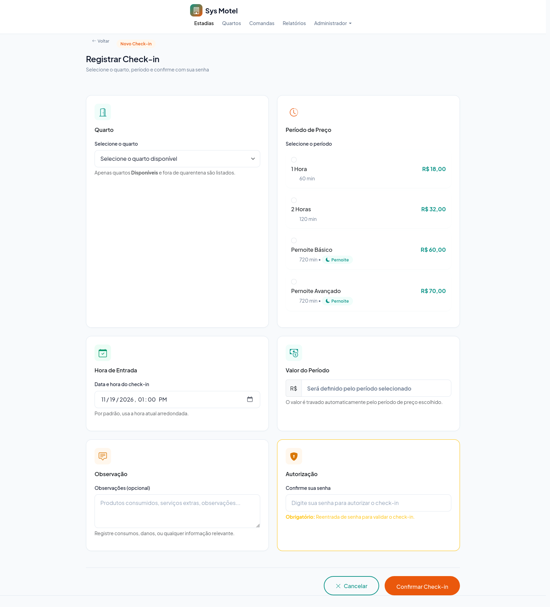
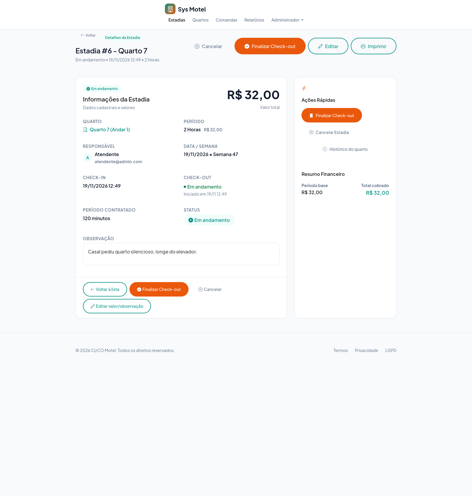
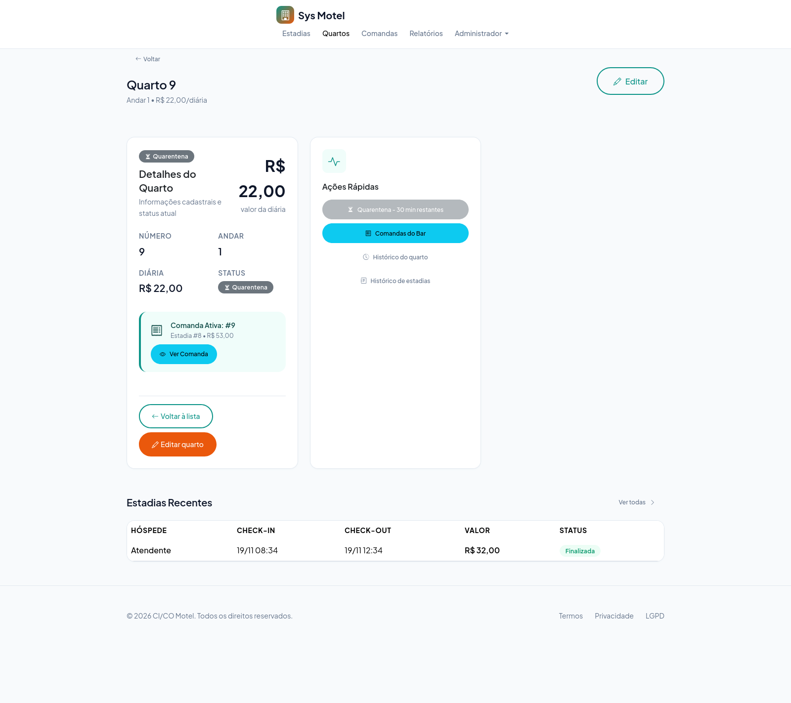
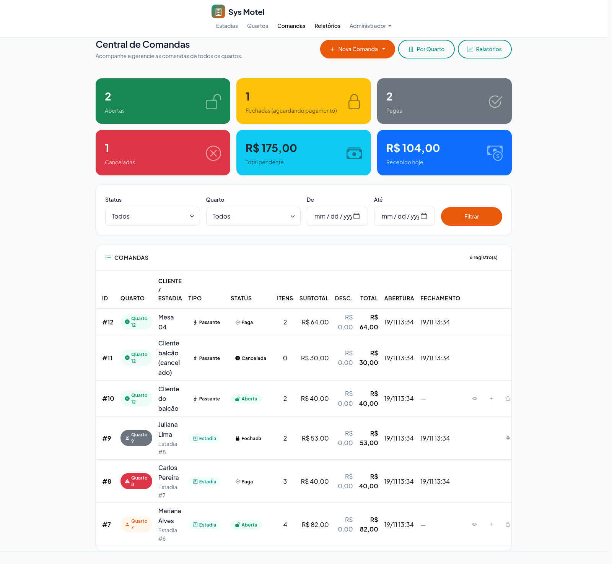
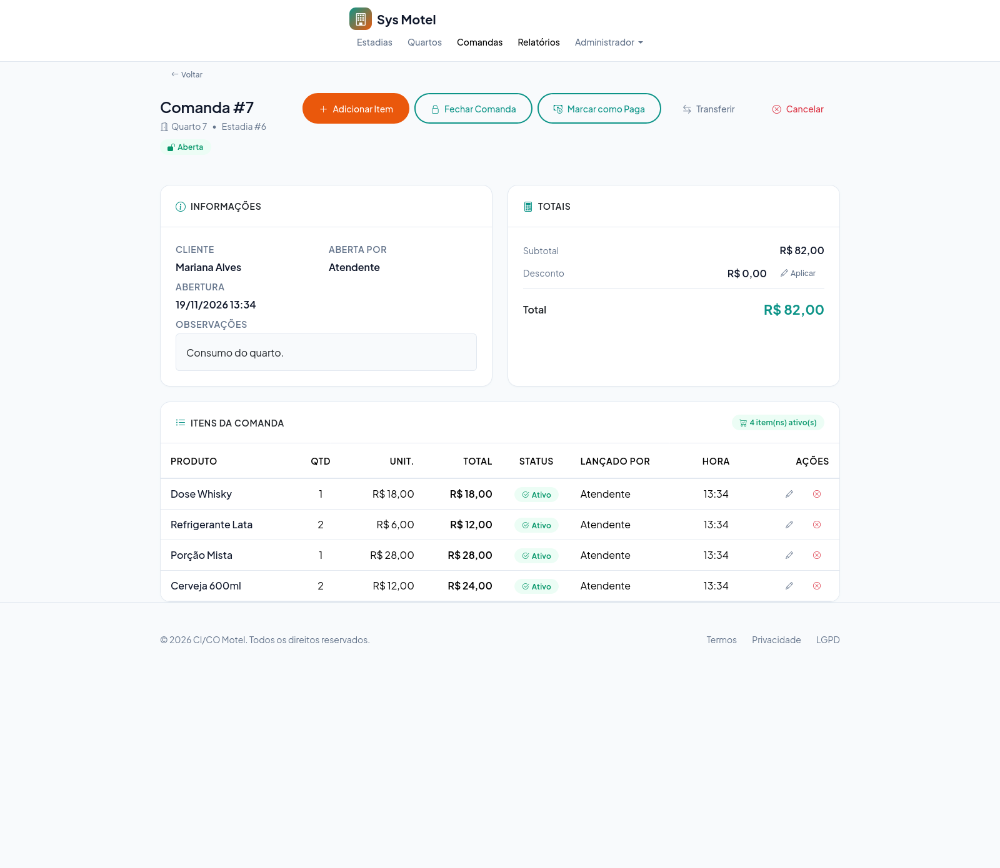

# CI/CO Motel

Sistema de check-in/check-out para motéis e hotéis, feito com **Rails 8.1**, **Bootstrap 5**, **Turbo/Stimulus**, **Solid Queue**, **Solid Cache** e **Solid Cable**.

[](https://github.com/codebyjonatas/CI_CO_motel/actions/workflows/ci.yml)
[](https://rubygems.org/gems/rails/8.1.4.1)
[](https://rubygems.org/gems/rails/8.1.4.1)
[](https://www.postgresql.org/)
[](LICENSE)

> Painel operacional, ciclo AASM de quartos, comandas de bar com itens e precificação dinâmica, autorização com Pundit e timestamps em UTC com fuso America/Sao_Paulo.

## Demo


[▶️ Ver demo ao vivo](https://demo.seudominio.com) · [📸 Screenshots](docs/screenshots/)

## Badges


## Índice

| Tela | Screenshot |
|---|---|
| Estadias |  |
| Check-in |  |
| Detalhe da estadia |  |
| Quartos |  |
| Quarto em limpeza |  |
| Quarentena |  |
| Histórico do quarto |  |
| Comandas |  |
| Detalhe da comanda |  |
| Relatórios |  |

## Arquitetura

### Models principais

- **Room** — AASM: `available → occupied → dirty → cleaning → quarantine → maintenance`; `RoomAuditable` registra cada transição em `RoomStatusLog`; `belongs_to :cleaned_by`.
- **Stay** — `status: { active: 0, completed: 1, cancelled: 2 }`; `total_value = price_period.price`; validação de período compatível com horário de check-in (Happy Hour / madrugada).
- **PricePeriod** — estrutura estática via `PricePeriodConfig` (não é model ativo). Períodos: `one_hour` (R$18/60min), `two_hours` (R$32/120min), `basic_overnight` (R$60/720min), `advanced_overnight` (R$70/720min).
- **Tab / TabItem** — comandas do bar; itens com quantidades, preço unitário/Total; descontos e totais recalculados automaticamente.
- **CleaningLog** — enum `started/finished/approved/rejected`; `cleaned_by` obrigatório (setado no check-out).
- **User** — Devise + Rolify; papéis `admin` e `attendant`.

### Queries (`app/queries`)

- `RoomHistoryQuery` — linha do tempo unificada: estadias, comandas, limpezas, mudanças de status.
- `TabDashboardQuery` — resumo operacional e filtros de status/data.
- `AvailableRoomsQuery` — quartos disponíveis para check-in agora (considera quarentena).
- `TabReportQuery` — faturamento por período, quarto, atendente e produtos mais vendidos.

### Services (`app/services`)

- `Stays::CheckInService` — validação de quarto, período, senha do atendente e criação atômica da estadia.
- `Stays::CheckOutService` — fecha comanda, define `check_out`, status `completed` e coloca quarto em `dirty` + `CleaningLog`.
- `Tabs::CloseService` / `Tabs::PayService` / `Tabs::CancelService` — operações de comanda com validação de limites de desconto.

### Auth & Authz

- **Devise** com `admin` e `attendant` roles (via Rolify).
- **Pundit** policies: `StayPolicy`, `RoomPolicy`, `TabPolicy`, `TabItemPolicy`, `ProductPolicy`.
- `Current` attribute object para contexto de usuário/trigger de status.

## Início Rápido

```bash
# 1. Clone o repositório
git clone https://github.com/codebyjonatas/CI_CO_motel.git
cd CI_CO_motel

# 2. Instale as dependências
brew bundle install  # ou: rvm use 4.0.5 && rvm gemset create ci-co-motel
# Ou manualmente:
bundle install && yarn install

# 3. Configure o banco e o fuso horário
cp .env.example .env.local   # ajuste RAILS_MASTER_KEY e APP_TIME_ZONE
export APP_TIME_ZONE="America/Sao_Paulo"

# 4. Crie o banco e faça o seed
bin/rails db:setup

# 5. Rode a aplicação
bin/dev   # ou: rails server
```

## Comandos Principais

| Tarefa | Comando |
|--------|---------|
| Rodar testes | `rails test` |
| Rodar testes de sistema | `rails test:system` |
| Lint | `bin/rubocop` |
| Scan segurança (Ruby) | `bin/brakeman` |
| Scan segurança (JS) | `bin/importmap audit` |
| Build CSS | `yarn build:css` |
| Watch CSS | `yarn watch:css` |

## ScreenShots estratégicos

As capturas abaixo foram geradas automaticamente e mostram os fluxos críticos do produto:

- **01-estadias.png** — Painel de estadias com filtros e resumo por status.
- **02-checkin.png** — Formulário de check-in com seleção de quarto, período e reautenticação de senha.
- **03-estadia.png** — Detalhe da estadia ativa com período, valor total e comanda vinculada.
- **04-quartos.png** — Cards de quartos com todos os status (disponível, ocupado, sujo, limpeza, quarentena, manutenção).
- **05-quarto-em-limpeza.png** — Quarto em estado `cleaning` com botão “Finalizar Limpeza”.
- **06-quarto-em-quarentena.png** — Quarto em quarentena com contador regressivo “X min restantes”.
- **07-historico-quarto.png** — Linha do tempo unificada do quarto (estadias, comandas, limpezas).
- **08-comandas.png** — Central de comandas com indicadores (abertas, fechadas, pagas, canceladas).
- **09-comanda.png** — Comanda aberta com itens, subtotal, desconto e total.
- **10-relatorios.png** — Relatórios de faturamento por período, quarto, atendente e produto.

## Deploy

O projeto já possui configuração **Kamal** para deploy Docker. Veja `.github/workflows/deploy.yml` e `config/deploy.yml`.

Para um deploy rápido:

```bash
# Variáveis de ambiente (no Bitwarden ou .env)
export APP_HOST=demo.seudominio.com
export RAILS_MASTER_KEY=sua-chave-secreta
export SYS_CHECK_IN_CHECK_OUT_DATABASE_PASSWORD=sua-senha-pg
export APP_TIME_ZONE="America/Sao_Paulo"

# Setup inicial
bin/kamal setup

# Deploy
bin/kamal deploy
```

## Licença

Distribuído sob a licença **MIT**. Veja [LICENSE](LICENSE) para mais detalhes.

## Contato

Desenvolvido por **Code by Jonatas** — [GitHub](https://github.com/codebyjonatas/CI_CO_motel)